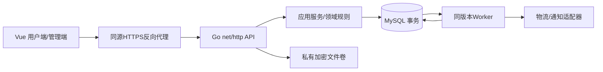

# 06 系统架构

**DESIGN_DECISION**：模块化单体，同源部署。Go net/http+database/sql+MySQL驱动；MySQL 8.4 InnoDB；Vue3/TypeScript/Vite，Vue Router及Pinia（仅会话/兑换临时状态）；后台Element Plus，用户端自有响应式组件。后台表格/日期/上传用成熟组件减少维护，禁止把layui/jquery复制进新站。版本在A1选受支持版本并锁go.sum/package lock及镜像digest，不在文档中猜“最新版本”。

无Redis、Kafka、微服务、独立对象存储默认依赖。MySQL存session、限流、任务/Outbox，私有文件挂载卷；一台机器部署成本低。以后多实例必须共享文件或接对象存储适配器，不能仅扩容API造成文件丢失。API与worker可同一可执行程序的不同command，同版本发布。

模块依赖：transport→application→domain+repository接口；mysql实现接口，boot负责装配。redemption service直接协调voucher/order/inventory/calendar repositories，不让领域互相调用HTTP。shipping不直接调用通知供应商，通过Outbox。没有分布式事务。

性能预算（自主验收目标）：单实例2CPU/4GiB应用+独立MySQL4GiB，普通读P95<300ms（本地100并发），兑换P95<1s不含验证码/外部系统；密码hash在目标机器校准，避免把耗时hash放在持行锁事务。性能预算已由 H1 实测，硬件、样本与边界见 H1-performance.md。可访问性目标WCAG AA常见表单/键盘对比度，不声称已认证。

API是新系统协议，OpenAPI3.1.1固定版本。[官方OpenAPI规范](https://spec.openapis.org/oas/v3.1.1.html)用于格式依据；事务采用sql.Tx，[Go官方事务说明](https://go.dev/doc/database/execute-transactions)。这些参考是技术依据，不是原站技术栈证明。
