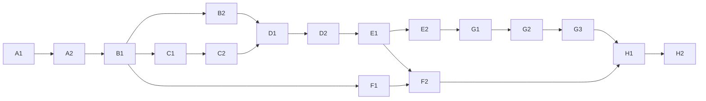

# 17 实施工作包

**DESIGN_DECISION**：17个可独立验收的工作包。每个分支只实现自己的范围，不改研究原件。建议先A1、A2、B1，再B2/C1并行；D2完成最小交易闭环，E2完成发货主链。模块实现必须附真实MySQL和契约测试。依赖以本表为准；文件名是计划，不代表已生成业务代码。

## A1 基础工程与契约流水线

|项目|可执行规格|
|---|---|
|目标|基础工程与契约流水线|
|业务范围|基础工程与契约流水线；关联测试 T22|
|前置依赖|无|
|修改文件|backend/cmd,internal/bootstrap,transport；frontend；deployments；tests/contract|
|数据库变更|schema_migrations及37表迁移骨架按依赖分文件|
|API变更|healthz/readyz；OpenAPI类型生成；精确operationId以09和OpenAPI为准|
|前端变更|两套Layout、Router、API Client|
|实现步骤|建立Compose/锁文件→配置secret读取→迁移命令→错误/slog→契约CI|
|测试要求|空库迁移、health、配置缺失拒启动、规范验证|
|完成标准|本地启动可重复，禁止默认生产秘密|
|明确不包含|领域业务实现|

## A2 身份会话与基础RBAC

|项目|可执行规格|
|---|---|
|目标|身份会话与基础RBAC|
|业务范围|身份会话与基础RBAC；关联测试 T01,T18|
|前置依赖|A1|
|修改文件|backend/internal/app/identity,infra/crypto；frontend/features/admin/auth|
|数据库变更|admin_users/roles/permissions关联、sessions/challenges/rate_limits/audit_logs|
|API变更|bootstrap/login/logout/reauth/changePassword；精确operationId以09和OpenAPI为准|
|前端变更|登录、挑战、强制改密、权限guard|
|实现步骤|CLI初始管理员→Argon2→cookie/CSRF→角色校验→审计|
|测试要求|T01/T18、session轮换、最后管理员保护|
|完成标准|未授权请求在服务端拒绝；审计不泄密|
|明确不包含|复杂角色UI/外部OAuth|

## B1 商品发布与公开目录基础

|项目|可执行规格|
|---|---|
|目标|商品发布与公开目录基础|
|业务范围|商品发布与公开目录基础；关联测试 T03|
|前置依赖|A2|
|修改文件|app/catalog,infra/mysql/products；frontend/features/catalog|
|数据库变更|categories/products/product_media/files/inventory_balances|
|API变更|products/category/uploadFile/status/publicProducts；精确operationId以09和OpenAPI为准|
|前端变更|商品表格/编辑/媒体、公开详情基础|
|实现步骤|字段校验→图片安全→零余额→DRAFT发布→快照接口|
|测试要求|T03、重复编码、XSS/恶意图|
|完成标准|新建商品在前台可见，停用阻止新兑|
|明确不包含|SKU/套餐子件/真实素材迁移|

## B2 库存单据与审核

|项目|可执行规格|
|---|---|
|目标|库存单据与审核|
|业务范围|库存单据与审核；关联测试 T08|
|前置依赖|B1|
|修改文件|app/inventory,domain/inventory；frontend/features/admin/inventory|
|数据库变更|inventory_documents/items/transactions|
|API变更|inventory/ledger/documents/approve/reject；精确operationId以09和OpenAPI为准|
|前端变更|余额、单据编辑、审核、流水|
|实现步骤|单据不动余额→审核锁序→条件更新→账本→审计|
|测试要求|T08真实MySQL并发审核|
|完成标准|每次审核一次账；available非负|
|明确不包含|兑换预占/发货扣减|

## C1 卡型批次与原子生成

|项目|可执行规格|
|---|---|
|目标|卡型批次与原子生成|
|业务范围|卡型批次与原子生成；关联测试 T02,T04,T12|
|前置依赖|B1,A2|
|修改文件|app/voucher,domain/voucher,worker/generation|
|数据库变更|voucher_types/batches/vouchers/voucher_products|
|API变更|types/batches/generate/getBatch/vouchers；精确operationId以09和OpenAPI为准|
|前端变更|卡型、批次、商品选择、任务状态|
|实现步骤|冻结策略→安全随机→hash→唯一约束→epoch/lease→整批原子|
|测试要求|T02/T04/T12|
|完成标准|1000张以内任务可恢复且无部分可用卡|
|明确不包含|导出封存界面与兑换|

## C2 安全发行与凭证生命周期

|项目|可执行规格|
|---|---|
|目标|安全发行与凭证生命周期|
|业务范围|安全发行与凭证生命周期；关联测试 T15,T19|
|前置依赖|C1|
|修改文件|infra/files,crypto；app/voucher；frontend/features/admin/vouchers|
|数据库变更|files credential映射、outbox、凭证版本|
|API变更|downloadFile/sealBatch/resetSecret/sealVoucher/bulkVouchers；精确operationId以09和OpenAPI为准|
|前端变更|导出、加密封存、激活停用、密码重置|
|实现步骤|短期密文→授权流下载→封存清理→重置撤会话→软删|
|测试要求|T15/T19、磁盘与日志扫描|
|完成标准|封存后无可下载secret，旧secret重置失效|
|明确不包含|真实卡券发送/印刷服务|

## D1 鉴真、选品、地址和日历

|项目|可执行规格|
|---|---|
|目标|鉴真、选品、地址和日历|
|业务范围|鉴真、选品、地址和日历；关联测试 T04,T10,T12,T13|
|前置依赖|B2,C2|
|修改文件|app/redemption,domain/calendar；frontend/features/voucher/redemption|
|数据库变更|sessions/challenges/shipping_calendars|
|API变更|verifyVoucher/options/calendar/regions；精确operationId以09和OpenAPI为准|
|前端变更|前台卡券入口、选择计数、地址日期、确认页|
|实现步骤|挑战→凭证校验→受限scope→选品规则→日历算法→字段映射|
|测试要求|T04/T10/T12/T13|
|完成标准|预览不核销、不占库存，前端错误可恢复|
|明确不包含|最终核销事务|

## D2 最小兑换订单事务

|项目|可执行规格|
|---|---|
|目标|最小兑换订单事务|
|业务范围|最小兑换订单事务；关联测试 T05,T06,T11|
|前置依赖|D1|
|修改文件|app/redemption,infra/mysql/tx；tests/integration|
|数据库变更|redemptions/orders/items/reservations/idempotency/outbox|
|API变更|redeem/customerOrder；精确operationId以09和OpenAPI为准|
|前端变更|确认提交、超时同键恢复、成功订单|
|实现步骤|幂等→锁卡/日历/商品/库存→核销/订单/账本/Outbox→commit|
|测试要求|T05/T06/T11及逐步故障注入|
|完成标准|前台下单→后台待发可读，100并发满足不变量|
|明确不包含|外部物流/售后|

## E1 订单查询编辑取消回收

|项目|可执行规格|
|---|---|
|目标|订单查询编辑取消回收|
|业务范围|订单查询编辑取消回收；关联测试 T07,T14,T18,T19|
|前置依赖|D2|
|修改文件|app/order；frontend/features/orders/admin/orders|
|数据库变更|orders版本、日历迁移、audit|
|API变更|queryOrder/stepUp/edit/cancel/trash/restore/privateView；精确operationId以09和OpenAPI为准|
|前端变更|用户查询/修改，后台各状态表/详情|
|实现步骤|READ与WRITE隔离→PII审计→修改截止→取消释放→软删恢复|
|测试要求|T07/T14/T18/T19|
|完成标准|并发改期不丢slot，取消不返卡，恢复不变状态|
|明确不包含|商品换货/现金退款|

## E2 人工发货、到店与基础物流

|项目|可执行规格|
|---|---|
|目标|人工发货、到店与基础物流|
|业务范围|人工发货、到店与基础物流；关联测试 T09|
|前置依赖|E1|
|修改文件|app/shipping,infra/integrations/mock；frontend/features/admin/shipping|
|数据库变更|carriers/shipments/events及库存账关联|
|API变更|shipOrder/pickup/customerTracking/orderComplete；精确operationId以09和OpenAPI为准|
|前端变更|物流公司/人工发货/到店核销/轨迹|
|实现步骤|全单唯一运单→预占转实扣→到店事务→签收完成|
|测试要求|T09、到店并发、原发重复|
|完成标准|14步E2E主链在MOCK上跑通|
|明确不包含|真实面单/短信|

## F1 公开页面与响应式完成

|项目|可执行规格|
|---|---|
|目标|公开页面与响应式完成|
|业务范围|公开页面与响应式完成；关联测试 T20|
|前置依赖|B1，可与C/D并行|
|修改文件|frontend/features/public,styles；app/content|
|数据库变更|content_pages|
|API变更|publicContent/content CRUD；精确operationId以09和OpenAPI为准|
|前端变更|首页、公告、须知、关于联系、商品栅格/详情|
|实现步骤|自有内容→路由别名→断点→焦点/键盘→视觉回归|
|测试要求|T20、390/768/1440截图|
|完成标准|公开页面完整且与真实API联动|
|明确不包含|复制目标站版权素材|

## F2 用户业务UI与反馈完成

|项目|可执行规格|
|---|---|
|目标|用户业务UI与反馈完成|
|业务范围|用户业务UI与反馈完成；关联测试 T18,T20|
|前置依赖|D2,E1,F1|
|修改文件|frontend/features/redemption/orders/feedback；app/feedback|
|数据库变更|feedback联系人密文|
|API变更|feedback、全部用户端错误分支；精确operationId以09和OpenAPI为准|
|前端变更|加载/空态/校验/超时/查询/反馈|
|实现步骤|补齐字段错误→同键恢复→保护地址→反馈挑战→无障碍|
|测试要求|T18/T20，弱网端到端|
|完成标准|所有用户操作有真实API和持久化结果|
|明确不包含|真实短信通知|

## G1 导入导出与批量管理

|项目|可执行规格|
|---|---|
|目标|导入导出与批量管理|
|业务范围|导入导出与批量管理；关联测试 T21,T15|
|前置依赖|C2,E2|
|修改文件|app/operations,worker/imports；frontend/features/admin/files|
|数据库变更|integration_jobs/files，批量有效期动作|
|API变更|import jobs/commit/export jobs/getJob/bulkVouchers；精确operationId以09和OpenAPI为准|
|前端变更|文件/预检/错误行/批量操作|
|实现步骤|UTF8预检→敏感导入加密→卡券整批/运单逐行→去重→过期清理|
|测试要求|T21/T15、重复文件和路径穿越|
|完成标准|错误可定位且不泄secret，任务可恢复|
|明确不包含|GBK/Excel宏/公共下载链接|

## G2 售后与可靠异步集成

|项目|可执行规格|
|---|---|
|目标|售后与可靠异步集成|
|业务范围|售后与可靠异步集成；关联测试 T16,T17|
|前置依赖|E2,G1|
|修改文件|app/aftersales,worker/outbox,infra/integrations；frontend/admin|
|数据库变更|after_sales/outbox/notifications|
|API变更|afterSales/decision/replacement/autoLabel/trackingWebhook/retry；精确operationId以09和OpenAPI为准|
|前端变更|售后、通知任务、供应商状态|
|实现步骤|案件锁→补发账→Outbox lease→幂等适配→未知结果核对|
|测试要求|T16/T17、回调乱序/重复/丢响应|
|完成标准|原订单不逆转，外部失败可追踪|
|明确不包含|未取得供应商契约的LIVE上线|

## G3 权限设置、内容运营与日志

|项目|可执行规格|
|---|---|
|目标|权限设置、内容运营与日志|
|业务范围|权限设置、内容运营与日志；关联测试 T01,T11,T18,T20|
|前置依赖|A2,E1,G2|
|修改文件|app/identity/operations；frontend/admin/settings|
|数据库变更|configs及RBAC/audit完整关系|
|API变更|admins/roles/permissions/config/dashboard/audit/notifications；精确operationId以09和OpenAPI为准|
|前端变更|权限树、设置、统计、审计、反馈处理|
|实现步骤|权限目录→细分操作→最后管理员锁→日历配置→审计筛选|
|测试要求|T01/T11/T18/T20|
|完成标准|52模板按范围处置，没有假按钮|
|明确不包含|微信营销/系统在线初始化|

## H1 一致性、安全及全链路验收

|项目|可执行规格|
|---|---|
|目标|一致性、安全及全链路验收|
|业务范围|一致性、安全及全链路验收；关联测试 T01–T22|
|前置依赖|A–G|
|修改文件|tests/integration,e2e,contract；worker/reconciliation|
|数据库变更|只增加必要索引，不改规则|
|API变更|inventoryReconcile及全契约回归；精确operationId以09和OpenAPI为准|
|前端变更|所有状态和权限截图回归|
|实现步骤|14步主链→异常矩阵→100并发→对账→EXPLAIN→修复|
|测试要求|T01–T22，go test -race|
|完成标准|契约/状态/账本/安全门禁全通过，保留报告|
|明确不包含|未验证即宣称生产就绪|

## H2 部署备份恢复与交接

|项目|可执行规格|
|---|---|
|目标|部署备份恢复与交接|
|业务范围|部署备份恢复与交接；关联测试 T22|
|前置依赖|H1|
|修改文件|deployments,runbooks,README|
|数据库变更|最终迁移checksum、备份演练库|
|API变更|health/ready运维策略；精确operationId以09和OpenAPI为准|
|前端变更|使用指南与演示自有数据|
|实现步骤|镜像digest→密钥检查→空库部署→备份恢复→回滚演练|
|测试要求|T22、RPO/RTO实测记录|
|完成标准|可从干净环境部署并恢复，交付操作手册|
|明确不包含|真实生产部署自动授权|

## 交付约定

每包提交：变更说明、迁移与OpenAPI diff、测试命令/结果、关键UI截图、已知风险。先审查当前git status并保留用户修改；仓库尚无Git时A1初始化本地Git需不覆盖文件。不替用户自动推送/部署生产。若发现规格冲突，修最小ADR+数据库/API/测试一整条链再编码，不用TODO留核心规则空缺。

## 交叉审核补充归属

B2实现setInventoryWarning；E2实现adminOrderShipments/adminShipmentEvents；G2实现getAfterSale、resolveJob、resolveNotification并覆盖T17；G1实现Job.phase PREVIEW/APPLY与commitImport并发保护。工作包前端菜单权限用OpenAPI的操作权限，不能把页面隐藏当作完成鉴权。A1负责完整初始DDL可运行验证，后续各包只追加必要迁移，不能反复重建37表。
