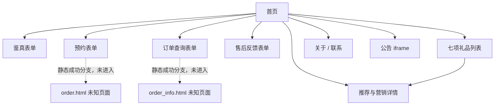

# 04 导航与页面关系

**OBSERVED**：以下可见入口和目标由[首页AX](evidence/ax/01-home.txt)、[列表AX](evidence/ax/06-products.txt)、[移动AX](evidence/ax/02-verify-mobile.txt)读取；所有目标页均另行打开核验，详见[26条记录](02-page-details.md)。并非每条导航边都实际点击过。

|来源组件|可见入口|目标路径|
|---|---|---|
|Logo/桌面主导航|首页|`/`|
|桌面导航|验证真伪|`/home/index/card_verify.html`|
|桌面导航|预约提货|`/home/index/card_exchange.html`|
|桌面导航|订单查询|`/home/index/order_query.html`|
|桌面导航|售后反馈|`/home/index/feedback.html`|
|桌面导航|礼品展示|`/home/index/product.html`|
|首页快捷入口|预约、查询、反馈|相应无`.html`后缀路径|
|首页快捷入口|礼品、关于、联系|`product_order`、`about_us`、`contact_us`（共同前缀`/home/index/`）|
|页脚|关于我们、联系方式|`/home/index/about_us.html`、`/home/index/contact_us.html`|
|页脚/自动弹窗|系统公告|iframe `/home/index/notice.html`|
|首页四项推荐|大闸蟹/礼包/苹果/花椒|`/home/index/product_detail.html?id=57/17/84/88`（每个ID为独立链接）|
|礼品列表|七项礼品|同上四项，另有ID13/86/78|
|首页三张营销轮播|小程序/提货系统/防伪|详情ID92/93/94|
|移动固定底栏|首页、鉴真、提货、进度、联系|首页index与对应公开页面；具体href见[源码](evidence/static/home.sanitized.html)|

**OBSERVED**：移动390×844下主导航折叠，点击菜单图标显示导航项：[展开截图](evidence/screenshots/02-mobile-menu.png)。首页Next切换轮播：[操作后截图](evidence/screenshots/01-home-carousel-next.png)。公告作为覆盖层显示，关闭后回到原页面：[弹窗AX](evidence/ax/20-notice-modal.txt)。详情可滚动，不需要卡券即可阅读：[详情93](evidence/ax/18-detail-93.txt)。

图中实线表示可见链接关系及目标页可达（**OBSERVED**），虚线是源码中的表单动作（**INFERRED**），不是已经执行的跳转。来源：[预约源码](evidence/static/exchange.sanitized.html)185/469–484行、[查询源码](evidence/static/order.sanitized.html)183/466–480行。

**INFERRED**：导航以普通a链接和完整HTML页面为主，符合多页面模式；不能仅由URL推断服务器路由实现。`order_one.html?id=…`仅存在于列表注释，未计作入口，也未访问。[列表源码](evidence/static/products.sanitized.html)204行及后续。

**UNKNOWN**：卡券校验后的选品路径、地址/日期页、订单确认、结果页、物流详情和售后处理页。没有从猜测路径扩展调查，也未进入外部技术支持站点、管理端或微信登录。
