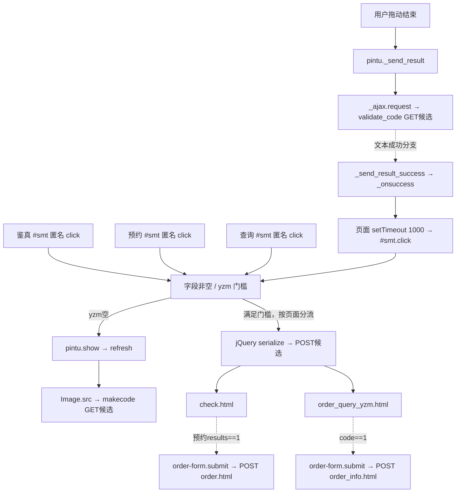

# 13 接口调用图与字段规格

以下全部业务调用图为 **INFERRED / STATIC_CANDIDATE**，除[14](14-network-evidence.md)明确列出的实际GET加载请求。匿名回调不虚构命名函数；V-click/E-click/Q-click/F-click是本文定位用别名。

## 三个Ajax候选由谁调用

|候选|真实源码调用者|构造/消费|定位|
|---|---|---|---|
|C01 POST `/home/index/check.html`|鉴真`$('#smt').click(function(){…})`（V-click）和预约同selector匿名回调（E-click）|`$('#order-form').serialize()`；鉴真读`results,tishi,product`，预约读`results,tishi`|[verify-1.js](evidence/phase2/focused-sources/verify-1.js)2/23；[exchange-1.js](evidence/phase2/focused-sources/exchange-1.js)2/24|
|C02 POST `/home/index/order_query_yzm.html`|查询`$('#smt').click(function(){…})`（Q-click）|`$('#order-form').serialize()`；读`code,msg`|[order-2.js](evidence/phase2/focused-sources/order-2.js)2/23|
|C03 POST `/home/index/feedback_send.html`|反馈`$('#smt').click(function(){…})`（F-click）|serialize后POST；读`code,msg`；成功后`clearForm`和回首页|[第一阶段feedback HTML](evidence/static/feedback.sanitized.html)409、441、456；本阶段未重复加载反馈页|

**INFERRED**：V/E/Q均先读卡号或查询字段，再判空，再判`#yzm`。yzm为空则触发`.pintu.click()`并return；非空才切换加载按钮并发送业务POST。F-click的实际流程以反馈源为准，不将三页验证门槛机械套用到反馈。

图只表达客户端静态设计；没有执行拖动、验证成功、业务POST或后续表单。REA check端点追踪识别两处源内候选：[trace](evidence/phase2/rea/check-feature-trace.json)。它不是服务器调用链。

## 两个表单目标

**INFERRED / STATIC_CANDIDATE**：F01 `order.html`来自预约`<form id="order-form" method="post" action="…">`；F02 `order_info.html`来自查询同类form。在各Ajax成功回调内调用`$('#order-form').submit()`，属于传统页面POST提交，不是第二个`$.post`或GET链接。默认编码静态上为`application/x-www-form-urlencoded`，真实请求头/状态/响应未观察，标 **UNKNOWN**。原始form：[exchange](evidence/static/exchange.sanitized.html)185、[order](evidence/static/order.sanitized.html)183。

|目标|静态序列化字段（字符串输入）|不应假设|
|---|---|---|
|C01/F01|`bianma`、`pass`、`__token__`|不包含无name的`yzm`；没有证明token为认证/CSRF；没有商品数量或地址字段证据|
|C02/F02|`bianma_jd`、`phone`、`__token__`|局部变量名bianma不是请求字段名；不证明手机号匹配规则|
|C03|`order_sn`、`xm`、`phone`、`email`、`message`、`__token__`|选填字段是否被后端接受空字符串未知|

**UNKNOWN**：返回字段真实类型/可空性、Content-Type、HTTP错误码和全部业务枚举。源码对1/2的比较只是分支比较，不能当成完整错误码表；没有构造模拟“真实响应”JSON。

## 新发现候选及后台边界

|编号|目标/方式|来源函数与参数|证据状态|
|---|---|---|---|
|V01|GET `/home/index/makecode`|`pintu.refresh`→Image.src；`t`随机数，可选`nowebp=1`|**INFERRED / STATIC_CANDIDATE**；未生成前台拼图|
|V02|GET `/home/index/validate_code`|`pintu._send_result`→`_ajax.request`；`xcode`数值位移转查询文本|**INFERRED / STATIC_CANDIDATE**；未验证拼图|
|A01|POST `/admin/login/login_check.html`|`.btn-login`匿名click→`$.ajax`；serialize `name,pass,yzm`，`dataType:'json'`|**INFERRED / STATIC_CANDIDATE**；未登录|
|A02|iframe GET目标 `/admin/login/edit.html`|`LoadUrl()`找回密码弹窗|**INFERRED / STATIC_CANDIDATE**；未打开找回页|
|A03|GET `/admin/login/yzm.html`|初始img src；`reloadcode()`另有时间戳刷新设计|初次图片请求 **OBSERVED** 200；刷新函数未执行，不混称已触发|
|A04|导航目标 `/admin/index/index.html`|登录success中`code === 1`→`location.href`|**INFERRED** 跳转候选，不是已可达后台/已观察API|

来源：[validate.js](evidence/phase2/focused-sources/validate.js)、[后台内联](evidence/phase2/admin-login-inline.js)、[后台HTML](evidence/phase2/admin-login.sanitized.html)。未经授权的目标未请求；前台两个验证端点与后台验证码图片不是同一个接口。

## 错误处理

**INFERRED**：三页业务POST只有成功回调，网络失败恢复未显式定义；验证码失败XHR回调为空、图片加载未见onerror。后台登录却有显式error回调：显示“网络错误，请重试”、恢复按钮；业务失败显示msg并刷新验证码。均为源代码解释，未制造网络失败验证。[后台内联](evidence/phase2/admin-login-inline.js)39–63；三页详见[15](15-voucher-workflow.md)、[16](16-order-workflow.md)。
