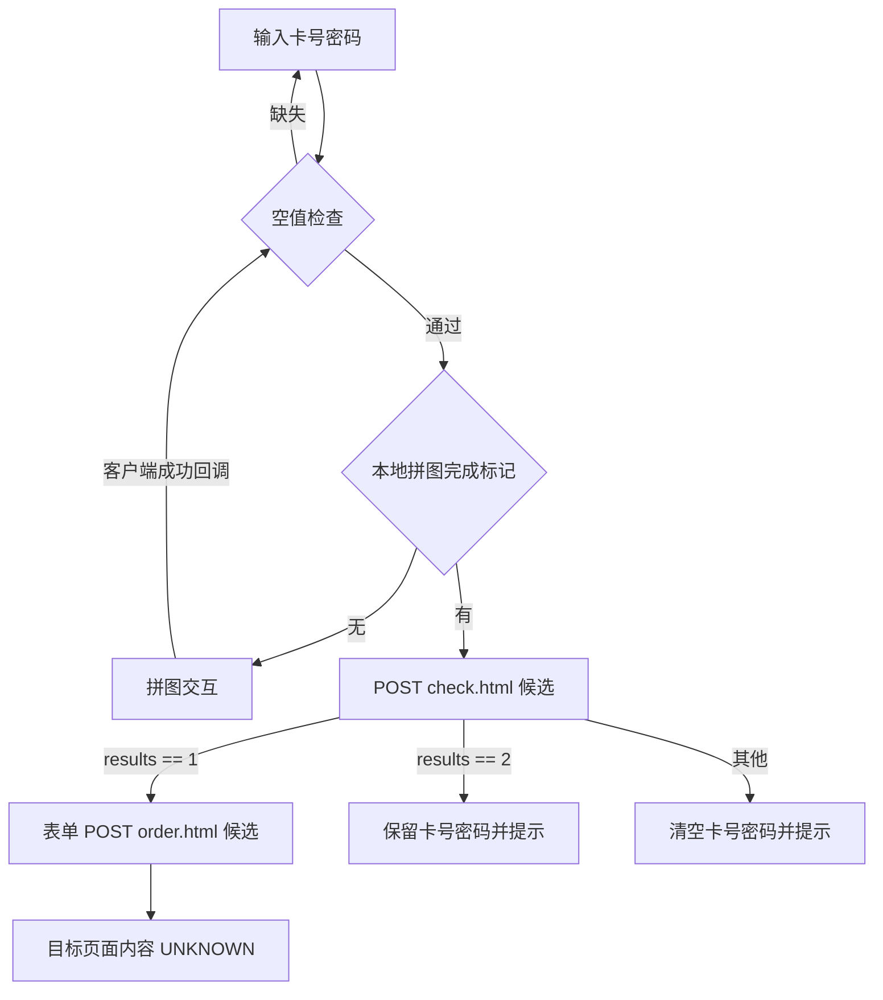

# 15 卡券鉴真与预约提货流程

本文件仅整理公开页面的客户端调用链。OBSERVED 指浏览器实际观察；INFERRED 指从捕获脚本或静态 HTML 推导出的行为；UNKNOWN 指尚未获得证据。STATIC_CANDIDATE 表示源码中的接口候选，不能据此断言已真实调用或服务端接受。请求实测状态以 [14 网络证据](14-network-evidence.md) 为准。

## 证据与定位

- V：[`card_verify` 页面事件脚本](evidence/phase2/verify-scripts/files/isolated/source-2-d7861d2ab6797d1ee14740b8c9c2961e6103a10e4e6b8430efa387444e673a21.js)，第 2–59 行；[导出 manifest](evidence/phase2/verify-scripts/manifest.json)。
- E：[`card_exchange` 页面事件脚本](evidence/phase2/exchange-scripts/files/isolated/source-2-9927d3c515472ccf6886827a294e52a7df80046718f7a18347ec97622d9b29bd.js)，第 2–57 行；[导出 manifest](evidence/phase2/exchange-scripts/manifest.json)。
- O：[`order_query` 页面事件脚本](evidence/phase2/order-scripts/files/isolated/source-3-db4d82038ed4145fe60e1e6cff40ead1c7b0a03f8fd36400ac5e1eef18194768.js)，第 2–46 行；[导出 manifest](evidence/phase2/order-scripts/manifest.json)。
- C：[`validate.js?v=88`](evidence/phase2/verify-scripts/files/isolated/source-5-7addd84b3be28cc706ebbf921edf30973d349630121b56934988259d141bbc1f.js)，压缩文件第 1–3 行；用下文函数名定位。

- H-V：[第一阶段鉴真 HTML](evidence/static/verify.sanitized.html)，202–239、247–248 行。
- H-E：[第一阶段预约 HTML](evidence/static/exchange.sanitized.html)，185–225 行。
- A-V：[第一阶段鉴真空输入](evidence/ax/02-verify-empty.txt)；A-E：[第一阶段预约空输入](evidence/ax/03-exchange-empty.txt)。

**OBSERVED**：REA 从浏览器公开鉴真、预约页面导出了 V、E、C 脚本（manifest 记录源 URL 与 hash）。导出证明该源码可被捕获，不证明所有函数均已运行；该取证过程没有使用卡密或提交业务。以下控制流据源码标为 INFERRED。

## 输入字段和序列化

| 字段 | 客户端含义与限制 | 证据和分类 |
|---|---|---|
| `bianma` | string；卡号；HTML type=email、maxlength=32；click 内仅判断空串，无 trim/格式正则 | INFERRED，H-V/H-E、V/E 3、7–10 行 |
| `pass` | string；密码；type=password、maxlength=20；仅判空；眼睛点击切换 password/text | INFERRED，H-V/H-E、V 46–54、E 44–52 |
| `__token__` | hidden string；进入表单序列化；值未记录，服务端用途未核验 | INFERRED，H-V/H-E；用途 UNKNOWN |
| `yzm` | hidden，本地拼图完成标记；只有 id 没有 name，故不进入 jQuery `serialize()` | INFERRED，H-V/H-E、C `_send_result_success` |

**INFERRED**：两页面业务请求的表单字段集合为 `bianma`、`pass`、`__token__`。按钮没有 name；`.pintu` 是 div，不产生字段。`type=email` 是原页面标记，不能将卡号业务定义为邮箱。脚本的 click 回调 `return false`，不应把 HTML 邮箱约束当成已观察到的卡号校验。（V/E；H-V/H-E）

**OBSERVED**：第一阶段清空卡号与密码后点提交，均出现“请输入卡号”。**INFERRED**：卡号非空、密码空将提示“请输入卡密码”；此分支由源码证实，未通过构造卡号测试。（A-V/A-E；V/E 7–18）

## 共享拼图调用链

**INFERRED**：C 第 3 行把 `pintu` 暴露为 `$HTH`，保留旧 `window.onload` 后调用 `pintu.init()`；init 动态插入遮罩、canvas、滑块、关闭/换图控件，绑定鼠标与触屏事件。页面原来的 `.pintu` 容器在 H-V/H-E 中 `display:none`，但业务 click 可程序化触发其事件。页面截图中没有可见拼图入口，不能据此认定没有验证码。

| 步骤 | 源码行为 | 状态和来源 |
|---|---|---|
| 1 | `#smt` 检查卡号、密码，再检查 `#yzm`；为空则 `.pintu.click()` 并退出 | INFERRED，V/E 2–19 |
| 2 | `pintu.show()` 调用 `refresh()`，显示遮罩与拼图 | INFERRED，C 第 2 行 |
| 3 | `refresh()` 创建 Image，设置 `/home/index/makecode?t=...`，不支持 WebP 时增加 `nowebp=1`；onload 绘图 | INFERRED，STATIC_CANDIDATE；C `refresh`。预期为图片资源，真实响应类型不能由源码确认 |
| 4 | 用户拖动结束 `_block_on_end()` 调 `_send_result()`，经 `_ajax.request` 发起 GET `/home/index/validate_code?xcode=...` | INFERRED，STATIC_CANDIDATE；C 第 1 行。参数为数值位移的 URL 字符串；未自动求解或手工构造请求 |
| 5 | 成功回调把响应当文本比较；匹配成功分支则设置 `#yzm`、`_result=true`，显示成功并安排隐藏；调用 `_onsuccess` | INFERRED，C `_send_result_success`。这不是已实测的服务端响应 |
| 6 | 页面注册的 `$HTH.onsuccess` 通过 setTimeout 约 1000ms 后重新触发 `#smt.click()` | INFERRED，V 55–59；E 53–57；无需第二次手动点击的客户端设计 |

**INFERRED**：失败文本分支清空 `#yzm`、显示失败并刷新挑战；`refresh()` 重置 `_result`、加载状态和滑块。关闭只是隐藏 UI。成功标记不是请求中的具名字段，因此无法从前端断言服务端只检查这个标记；后端是否使用会话、一次性挑战、有效期和重放保护均 **UNKNOWN**。（C `_send_result_success`、`refresh`、`hide`；H-V/H-E）

**INFERRED**：验证码 XHR wrapper 只将 HTTP 200 交给 success；失败处理函数为空，图片未见 `onerror`，未见 timeout。非 200 路径还引用作用域内未定义的 `status`，实际是否抛错取决于运行环境。这里只记录潜在恢复缺口，未制造故障，也不是绕过验证的证明。（C `_ajax.request`、`_send_result_failure`、`refresh`）

## 鉴真结果分支

**INFERRED / STATIC_CANDIDATE**：V 21–41 将按钮置为禁用/“验证中，请稍候...”，执行 `$.post('/home/index/check.html', $('#order-form').serialize(), callback)`。函数是绑定在 `#smt` 上的匿名 click 回调；没有命名的业务 API 封装，也未显式指定 dataType。默认表单编码的推断须与真实 Content-Type 分开。（V）

| `d.results` 客户端比较 | 页面处理 | 分类 |
|---|---|---|
| `==1` | 滚动到 `#tishi`；清空卡号密码；`#tishi` 写入 `d.tishi`、`#msg` 写入 `d.product`，均调用 `.html()` 和 slideDown | INFERRED，V 25–29 |
| `==2` | 弹出 `d.tishi`；保留卡号密码 | INFERRED，V 31–32 |
| 其他 | 清空卡号密码；弹出 `d.tishi` | INFERRED，V 34–36 |
| 回调收尾 | 清空 `#yzm`，重置拼图提示，恢复“确定提交”和可点击状态 | INFERRED，V 38–40 |

**UNKNOWN**：真实响应 Content-Type、完整 JSON schema、`results` 是数值还是数字字符串、各业务错误码含义、卡券到期/已核销/冻结的映射。`.html(d.product)` 仅说明客户端把该字段作 HTML 渲染，不能证实其内容一定是商品列表，更不能据此确认多商品选择能力。（V；14 网络证据）

**INFERRED**：未见 `.fail()`/`.always()`、超时或异常兜底；业务网络异常可能使按钮保持禁用。后续授权测试应验证恢复行为。鉴真新请求前也未见主动清空旧 `#tishi/#msg`，失败后旧结果是否仍可见须运行验证。（V 21–41）

## 预约提货状态转换

**INFERRED**：上图是 E 和 C 的客户端控制流，不是经过服务端验证的业务状态机。E 24–38 的 `results==1` 调 `$('#order-form').submit()`；H-E 第 185 行 `method=post`、`action=/home/index/order.html`（method 属性虽重复但同值）。因此目标是 **POST 表单导航候选**，不是 GET 跳转，也不是已创建订单。提交后回调仍执行清空本地验证码、恢复按钮的语句。（E、H-E）

**UNKNOWN**：`order.html` 成功页面、选择组件、商品 ID/数量字段、地址/预约日期字段、最终订单创建接口均未获得授权成功流程证据。当前入口脚本里没有多商品选择或数量约束实现。公开礼品列表和 `d.product` HTML 渲染不能填补这一缺口。

## 一卡多商品仍需验证

| 问题 | 当前结论 | 合法验证条件 |
|---|---|---|
| 一卡可选一个、多个、固定组合，还是按金额抵扣 | UNKNOWN | 管理方提供规则说明及对应沙箱卡类型 |
| 是否可分次兑换、剩余额度或剩余数量如何保留 | UNKNOWN | 可回滚测试环境，覆盖部分兑换、再次进入、失效等状态 |
| 可选商品来自卡类型、批次还是单卡配置 | UNKNOWN | 授权配置页只读观察及脱敏关联示例 |
| 库存不足、跨商品限额、配送范围与日期限制 | UNKNOWN | 允许失败用例的沙箱数据及明确约束 |
| 核销发生于鉴权、选品、提交还是发货 | UNKNOWN | 可审计的测试记录；不得在现有演示站推测或触发真实核销 |

**INFERRED（新系统自主设计建议）**：先独立实现无真实业务调用的输入、错误提示和选择组件原型；兑换规则、幂等、库存扣减与核销事务须在明确契约后设计。这些建议不代表原站已采用此方案。
