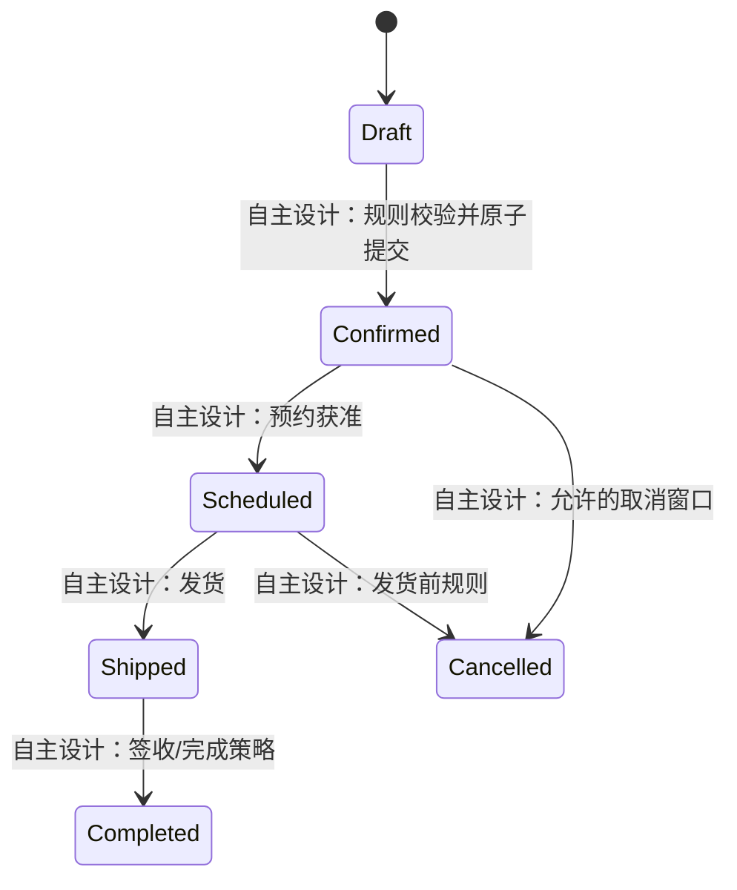

# 18 业务契约候选：原站证据与自主设计

本文件不是原网站数据库或服务器源码。表中 **INFERRED / DESIGN_PROPOSAL** 明确表示新系统拟采用的自主设计，需业务方评审；不能反向声称原站如此实现。原站输入/分支来源见[13](13-api-call-graph.md)、[15](15-voucher-workflow.md)、[16](16-order-workflow.md)，后台边界见[17](17-admin-research.md)。

## 原站可支持的最小事实

|对象/规则|证据级别|当前契约边界|
|---|---|---|
|商品展示|**OBSERVED** 第一阶段列表/详情|有展示ID、名称、图文及不统一属性；不是完整SKU/库存模型。见[P06–P19](02-page-details.md)|
|卡券鉴真输入|**INFERRED** 捕获JS+表单|bianma/pass，token隐藏字段；消费者期望results/tishi/product，未取得真实响应|
|预约入口|**INFERRED** 捕获JS|校验成功设计上POST到order.html；不能确认创建订单、核销或选品|
|订单查询输入|**INFERRED** 捕获JS+表单|bianma_jd/phone，code/msg消费者；成功设计上POST到order_info.html|
|物流和修改|**OBSERVED** 页面宣传文案；实现 **UNKNOWN**|仅声称可查询轨迹/修改未发货订单，无实际物流字段/修改接口|
|多商品权益|**UNKNOWN**|公开展示与营销说明不足确定选择基数、剩余权益、兑换次数|
|管理实体|**UNKNOWN**|登录前页面没有商品、批次、订单、角色的真实管理字段|

## 新系统实体及关系草案

以下全部 **INFERRED / DESIGN_PROPOSAL**，字段名、表名和关系均为自主命名，不能用作原站接口兼容声明。

|候选实体|自主字段示例|关系与待裁决事项|
|---|---|---|
|Product|id、name、description、media、displayAttributes、status|1:N SKU；是否需要SKU须确认，演示详情属性可先按展示数据处理|
|SKU|id、productId、specification、stockPolicy|订单项引用SKU或Product待定；不从页面价格推断结算金额|
|VoucherType|id、name、selectionPolicy、validityPolicy|1:N VoucherBatch；selectionPolicy只保留可配置接口，支持类型未知|
|VoucherBatch|id、typeId、issuedAt、expiresAt|1:N Voucher；批次覆盖卡型规则还是继承需确认|
|Voucher|id、code、secretHash、batchId、lifecycle、version|凭证只存安全验证材料；原站存储方式未知；权益不与展示详情ID机械等同|
|Entitlement|id、voucherId、eligibleItemSet、quantityOrBudget|适用商品、数量/额度、已用权益均待规则确认，不能先固定“任选N件”|
|Redemption|id、voucherId、idempotencyKey、state|Voucher与Order之间是否1:1或1:N未知；草案引入独立兑换记录支持审计|
|Order / OrderItem|orderNo、redemptionId、recipientRef、requestedShipDate、state / itemId、quantity、snapshot|订单项是否多个、拆单多地址未知；PII收集和保存由正式系统另定|
|Shipment / TrackingEvent|carrier、trackingNo、status / occurredAt、description|可以设计适配层，原站物流供应商/字段未知|
|Feedback|id、orderRef、contactRef、message、status|原站只确认反馈输入，工单生命周期未知|
|Admin / Role / Permission|id、roleIds / permissionKeys|自主RBAC草案；没有原站权限矩阵证据|

**INFERRED / DESIGN_PROPOSAL**：展示目录可先实现，卡权益、兑换与订单以独立接口隔离；最终关系基数必须由测试卡和业务规则确认。敏感收货资料不从演示站拷贝。

## 状态机草案

上述全部 **INFERRED / DESIGN_PROPOSAL**。原站订单枚举、是否存在Draft/Scheduled/Completed、取消能力均 **UNKNOWN**；图只为后续评审准备。卡券状态可提出未激活/可用/使用中/已兑/过期/冻结，但这些也不是原站已确认枚举。不得把取消、退款、权益返还自动视为必有功能。

## 兑换规则的决策接口

**INFERRED / DESIGN_PROPOSAL**：规则服务需要明确回答：某卡可选集合、选择总量/预算、同商品上限、规格限制、日期与区域资格、库存是否可满足、权益是否必须一次用完。每个答案都应有规则版本与可测试案例；目前这些原站业务值均 **UNKNOWN**，见[19](19-unresolved-business-rules.md)。

**INFERRED / DESIGN_PROPOSAL**：在真正创建订单/核销的边界，采用幂等键、事务或等效原子保证、并发版本检查、失败可重试和审计记录。当前没有证据判定原站使用何种技术方案；这是新系统可靠性要求草案。

## 接口与错误规则

原站可用字段规格限[13](13-api-call-graph.md)：名称来自form，输入类型为字符串；`results/code`实际JSON类型、tishi/product HTML内容、认证及验证码关联 **UNKNOWN**。新系统建议采用结构化错误，如FIELD_REQUIRED、VOUCHER_INVALID、VOUCHER_EXPIRED、OUT_OF_STOCK、SELECTION_INVALID、DATE_UNAVAILABLE、RETRYABLE_FAILURE；这些名称全部 **INFERRED / DESIGN_PROPOSAL**，不能映射为原站数字错误码。

**INFERRED / DESIGN_PROPOSAL**：前后端统一长度/空格/手机号策略，避免复制卡号type=email、旧手机号正则和反馈200/210不一致；成功/失败都恢复可操作UI，区分可重试网络错误与不可重试业务拒绝。验证码通过必须由服务端验证关联，客户端本地标记不能作为安全契约。

本阶段没有创建上述实体的代码、数据库迁移或实际接口。
