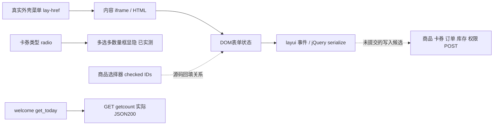

# 09 前端资源与调用关系

**LIVE_OBSERVED**：真实后台使用外壳+内容iframe，页面正常加载jQuery、layui、layuiAdmin模块、KindEditor编辑器资源及公共样式。源码URL与模块Initiator都在[网络索引](evidence/network-index.json)和逐页DOM的scripts字段中。没有把路径扩展名推断为后端框架或数据库。

**SOURCE_OBSERVED**：读取已经加载的页面内联脚本，按代码行保存端点、事件和函数摘录；三个空白业务表单/选择器额外保留完整内联段。摘录行号是“该内联script内部行号”，不是浏览器HTML行号。缺上下文时不声称已证明完整分支。复杂跨文件依赖未成为当前阻塞，故本轮没有重复REA；旧二期REA结果仍保留。

|页面/调用入口|关系|证据层级与来源|
|---|---|---|
|首页get_today|jQuery GET getcount → JSON统计字段|LIVE_OBSERVED网络栈：[welcome](evidence/welcome-deep-network.json)|
|添加商品submit(product)|名称非空→serialize add-form→POST add_check→code/msg提示与恢复|SOURCE_OBSERVED，未提交：[完整内联](evidence/product-add-deep-full-inline.json)|
|商品列表状态/排序|状态switch→onestatus；排序处理→update_sort|SOURCE_OBSERVED，未操作：[列表](evidence/product-list-deep-source-excerpts.json)|
|卡券radio(card_type)|value=2 slideDown product_num，否则slideUp|SOURCE_OBSERVED代码+LIVE_OBSERVED切换：[脚本](evidence/voucher-batch-deep-full-inline.json)、[后态](evidence/voucher-multi-dom.json)|
|卡券.getproduct|layer.open→product/select_list?prodid|SOURCE_OBSERVED；选择器文档另行实际GET：[批量](evidence/voucher-batch-deep-full-inline.json)|
|选择器.rselect|checked qx_id→arr IDs/pro名称→parent product/productlist→关闭层|SOURCE_OBSERVED，未执行确定选择：[选择器](evidence/product-selector-full-inline.json)|
|卡券submit(batch)|数量/前缀检查→serialize→POST batch_code→code/count/msg/pici|SOURCE_OBSERVED / STATIC_CANDIDATE，同批量脚本|
|卡券激活submit(sn/pici/prod/date)|各表单serialize→POST staupdate|SOURCE_OBSERVED / STATIC_CANDIDATE：[激活](evidence/voucher-activation-source-excerpts.json)|
|订单.getinfo/.editfwm|行order_sn/oid→详情/编辑iframe路径|SOURCE_OBSERVED构造；LIVE_OBSERVED已打开对应文档：[待发](evidence/order-pending-deep-source-excerpts.json)|
|订单编辑submit(code)|serialize edit-form→POST editcheck|SOURCE_OBSERVED / STATIC_CANDIDATE：[编辑](evidence/order-edit-source-excerpts.json)|
|人工发货submit(code)|serialize edit-form→POST fahuo_check|SOURCE_OBSERVED / STATIC_CANDIDATE：[发货](evidence/shipping-manual-form-source-excerpts.json)|
|入库/出库submit(user)|serialize add-form→各自add_check|SOURCE_OBSERVED / STATIC_CANDIDATE：[入库](evidence/inbound-add-source-excerpts.json)、[出库](evidence/outbound-add-source-excerpts.json)|
|角色submit(edit)|serialize edit-form→POST group_edit2|SOURCE_OBSERVED / STATIC_CANDIDATE：[角色](evidence/role-edit-source-excerpts.json)|

**INFERRED**：这是前端调用关系，不是后端服务图。共享脚本包含清缓存等函数，不意味着每页打开就调用。只有网络事务能证明发生请求；静态候选与实际API见[08](08-live-api-inventory.md)。前台鉴真/预约流程仍以[原二期调用链](../13-api-call-graph.md)为准，两端之间没有完整实测交易关联。
